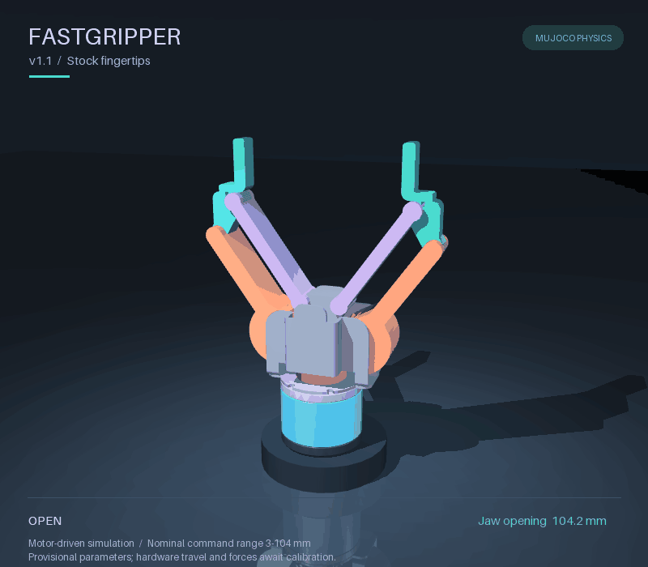

# FastGripper MuJoCo

Use FastGripper in MuJoCo: simulate contact-driven grasps, attach the gripper to
a robot, and train policies through Python. The `fastgripper-sim` package bundles
the models, controller and examples needed to run without CAD software.



*v1.1 stock metal tips · torque-driven MuJoCo motion · provisional 3–104 mm command range*

The package defaults to the **hardware v1.0 simulation baseline** and adds
explicit **v1.1** selection with separate carriers and rigid `stock-metal`
fingertips. Software, assets and hardware have separate versions; see
[model selection](docs/models.md) and [versions and releases](docs/releases.md).
The bundled trained policy remains v1.0-only. TPU Fin Ray geometry and compliant
tip physics are not included in this package.

## Start in five minutes

Install Python 3.12 and [uv](https://docs.astral.sh/uv/), then run these commands
from the repository root:

```sh
uv sync --locked
uv run --locked python -m fastgripper_sim.assets
uv run --locked python -m fastgripper_sim.demo
```

The last command runs a headless close, hold, lift, lower and release trial and
writes `outputs/grasp.json`. The block moves through contact and gravity. The
external fixture supplies the lift; the block is never attached to the fingers.

To watch or interact with the same simulation:

```sh
uv run --locked python -m fastgripper_sim.viewer --demo
uv run --locked python -m fastgripper_sim.demo --render
```

In the viewer, **G** grasps, **O** opens, **D** toggles the cycle, **M** toggles
the motor, **Space** pauses and **R** resets. On macOS the viewer launches through
MuJoCo's `mjpython`. Rendering produces `outputs/grasp.gif` and `outputs/grasp.png`.
Headless simulation and training do not need a viewer or rendering backend.

To run the v1.1 stock-tip configuration:

```sh
uv run --locked python -m fastgripper_sim.variant_demo --hardware v1.1 --tip stock-metal --viewer
```

Omit `--viewer` for a headless trial with hardware/tip provenance in its report,
or use `--render` to save a GIF and PNG. See the
[selection API and model limits](docs/models.md).

## Choose your next step

| Goal | Guide |
| --- | --- |
| Understand what the package simulates | [Runtime and limits](docs/runtime.md) |
| Select v1.0/v1.1 and a bundled tip | [Hardware and fingertip selection](docs/models.md) |
| Control the gripper or add it to your scene | [Python and scene integration](docs/integration.md) |
| Run a policy or train a new one | [Learning example](learning.md) |
| Use a UR5e or UR3e in MuJoCo | [Mounted arm examples](arm.md) |
| Exercise PolyScope and the FastGripper URCap | [Optional URSim integration](ursim.md) |
| Design or simulate custom fingertips | [Fingertip customization](docs/fingertips.md) |
| Install a wheel or pin a model version | [Installation](docs/installation.md) · [Releases](docs/releases.md) |

For policy training, call MuJoCo and the Python controller directly. URSim,
PolyScope and the URCap are optional application-integration tools.

## Model fidelity

The gripper has articulated linkages, explicit inertias, collision envelopes and
an effective motor/transmission model. Motor response, mass, friction, backlash,
travel and contact parameters remain provisional. Simulation results are not
hardware payload, accuracy, force or power-off holding ratings. Bundled UR mounts
are provisional adapters. See [the model guide](assets/fastgripper/README.md).

## Use and contributions

The licensing split supports using the simulation and building compatible
fingertips while reserving the gripper's mechanical design. The licensor is
Transcend Mechanics, Inc. Read
[LICENSE](LICENSE), [code terms](LICENSE-CODE) and [asset/accessory terms](LICENSE-ASSETS)
for the applicable permissions and scope. Bundled robot models retain their own licenses.
For bug reports and changes, see [CONTRIBUTING.md](CONTRIBUTING.md).
